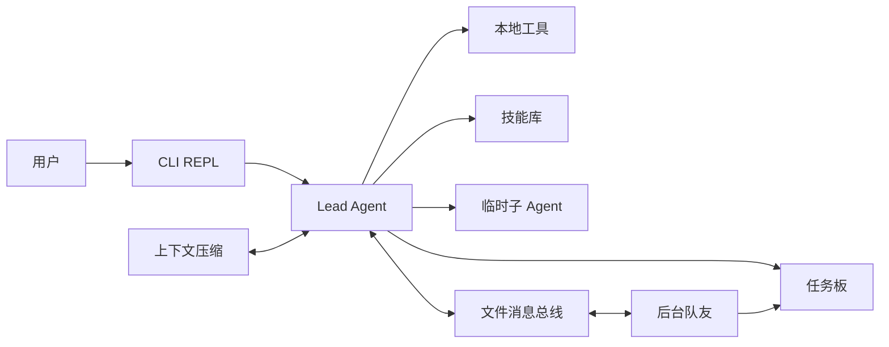

# LocalDev Agent

一个基于 Python 的本地开发编码 Agent。它通过 Anthropic Messages API 驱动主 Agent，在当前工作目录中执行命令、读写文件、管理任务，并按需调用子 Agent、后台队友和本地技能。

> 项目版本：`0.1.0`　｜　Python：`>=3.10`

## 功能概览

- **交互式 CLI**：持续对话、查看任务板、团队和收件箱。
- **本地开发工具**：执行 shell 命令，浏览目录，读取、写入和局部编辑文件。
- **双层任务管理**：
  - `TodoWrite` 管理当前会话内的短时步骤；
  - `TaskManager` 将任务、负责人和依赖关系持久化到 `.tasks/`。
- **子 Agent**：为主 Agent 提供隔离上下文的临时执行单元。
- **多 Agent 协作**：创建后台队友，通过共享任务板和 JSONL 收件箱进行协作。
- **按需技能**：从 `skills/` 递归发现 `SKILL.md`，由 Agent 通过 `load_skill` 加载。
- **上下文压缩**：自动清理旧工具结果，并在上下文过长时生成摘要、保存完整转录。
- **后台命令**：异步运行耗时命令，并在完成时把结果送回主对话。

## 工作方式



主 Agent 维护共享对话；临时子 Agent 和后台队友使用各自的上下文。队友通过 `.team/inbox/*.jsonl` 接收消息，并可以认领任务板中未阻塞的任务。

## 快速开始

### 1. 安装依赖

建议使用虚拟环境：

```bash
python3 -m venv .venv
source .venv/bin/activate
python -m pip install -e .
```

### 2. 配置模型访问

在项目根目录创建 `.env`：

```dotenv
# 必填：传给 Anthropic Messages API 的模型 ID
MODEL_ID=your-model-id

# Anthropic SDK 使用的 API Key
ANTHROPIC_API_KEY=your-api-key

# 可选：兼容 Anthropic 协议的代理或网关地址
# ANTHROPIC_BASE_URL=https://your-gateway.example.com
```

配置加载规则：

- 配置会在导入 `localdev.config` 时读取，`MODEL_ID` 必须存在。
- 项目使用 `python-dotenv` 的 `override=True`；如果 `.env` 中存在同名变量，它会覆盖当前进程环境变量。
- 设置 `ANTHROPIC_BASE_URL` 后，程序会移除 `ANTHROPIC_AUTH_TOKEN`，随后由 Anthropic SDK 使用剩余的环境配置发起请求。
- `.env` 可能包含 API Key，请勿将其提交到版本控制。

### 3. 启动

必须进入希望 Agent 操作的项目目录，再运行入口脚本：

```bash
cd /path/to/your/project
python /path/to/localdev_agent/run.py
```

也可以直接在当前项目根目录启动：

```bash
python run.py
```

启动后进入交互提示符：

```text
localdev >>
```

> **注意**：Agent 的工作目录由启动时的 `Path.cwd()` 决定，并不固定为源码仓库。`skills/`、`.tasks/`、`.team/` 和 `.transcripts/` 也都会相对于该目录查找或创建。若要在本仓库使用内置技能，请从本仓库根目录启动。

## CLI 命令

| 命令 | 作用 |
| --- | --- |
| `/compact` | 立即压缩当前对话，并将完整转录保存到 `.transcripts/` |
| `/tasks` | 查看持久化任务板 |
| `/team` | 查看队友名称、角色和状态 |
| `/inbox` | 读取并清空 Lead Agent 的收件箱 |
| `exit` / `q` / 空输入 | 退出 |

除内置命令外，其他输入会作为自然语言请求交给 Lead Agent。Agent 会根据需要自行调用工具。

## 内置工具

Lead Agent 当前注册了 24 个工具：

| 类别 | 工具 |
| --- | --- |
| 文件与目录 | `list_dir`、`read_file`、`write_file`、`edit_file` |
| Shell | `bash`、`background_run`、`check_background` |
| 计划与任务 | `TodoWrite`、`task_create`、`task_get`、`task_update`、`task_list`、`claim_task` |
| Agent 编排 | `task`、`spawn_teammate`、`list_teammates`、`shutdown_request`、`plan_approval` |
| 团队通信 | `send_message`、`read_inbox`、`broadcast` |
| 其他 | `load_skill`、`compress`、`idle` |

### 子 Agent

`task` 工具会创建一个隔离上下文的临时 Agent：

- `agent_type="Explore"`：只有 shell 和文件读取能力，适合代码探索。
- 其他 `agent_type`：额外获得文件写入和编辑能力，适合实现类子任务。
- 子 Agent 最多执行 30 轮工具调用，完成后仅把最终摘要返回主 Agent。

子 Agent 与后台队友不同：子 Agent 同步执行，使用完即结束；队友是独立线程，可在空闲时继续等待消息或自动认领任务。

## 任务与持久化

### 短时 Todo

`TodoWrite` 使用内存中的 `TodoManager`，适合单次任务内的步骤跟踪：

- 状态：`pending`、`in_progress`、`completed`
- 最多 20 项
- 同一时间最多一个 `in_progress`
- 每项必须提供 `content` 和 `activeForm`

该列表不会跨进程保存。

### 持久任务板

`TaskManager` 将每项任务保存为 `.tasks/task_<id>.json`，支持：

- 状态：`pending`、`in_progress`、`completed`、`deleted`
- 负责人 `owner`
- 依赖关系 `blockedBy` / `blocks`
- 队友自动认领无负责人、无阻塞的待办任务
- 任务完成后自动从其他任务的阻塞列表中移除

### 运行数据目录

| 路径 | 内容 |
| --- | --- |
| `.tasks/` | 持久化任务 JSON 文件 |
| `.team/config.json` | 团队成员、角色和状态 |
| `.team/inbox/` | 每个 Agent 的 JSONL 收件箱 |
| `.transcripts/` | 上下文压缩前保存的完整对话转录 |

收件箱采用“读取即清空”语义；`/inbox` 和 `read_inbox` 都会消费其中的消息。

## 技能系统

技能存放在 `skills/` 下的任意层级，每个技能包含一个 `SKILL.md`：

```markdown
---
name: my-skill
description: 技能用途说明
---

# My Skill

这里写该技能被加载后提供给 Agent 的完整指导。
```

`SkillLoader` 会在启动时递归扫描所有 `SKILL.md`，把技能名称和描述加入主 Agent 的系统提示，并通过 `load_skill` 按需加载正文。

仓库当前包含：

- `agent-builder`
- `code-review`
- `mcp-builder`
- `pdf`

## 上下文压缩

项目实现两层上下文控制：

1. **Micro-compaction**：保留最近 3 个 `tool_result`，把更早且超过 100 字符的结果替换为 `[cleared]`。
2. **Auto-compaction**：粗略估算对话超过 `100000` tokens 时，先把完整对话写入 `.transcripts/`，再调用模型生成连续性摘要，并用摘要替换当前上下文。

也可以输入 `/compact` 主动触发宏观压缩。压缩会产生额外的模型调用和费用。

## 项目结构

```text
.
├── run.py                         # CLI 入口
├── pyproject.toml                 # 包信息与依赖
├── exactly_restored.md            # 核心模块与流程的详细分析
├── skills/                        # 本地技能
│   ├── agent-builder/
│   ├── code-review/
│   ├── mcp-builder/
│   └── pdf/
├── src/localdev/
│   ├── config.py                  # 路径、模型、运行参数
│   ├── cli/repl.py                # 交互式命令行
│   ├── core/
│   │   ├── agent.py               # 主循环、子 Agent、工具上下文
│   │   ├── llm.py                 # 模型调用封装
│   │   └── memory.py              # 上下文压缩与转录
│   ├── multiagent/
│   │   ├── bus.py                 # JSONL 消息总线
│   │   ├── protocol.py            # 关闭与计划审批协议
│   │   └── team.py                # 队友生命周期与工作循环
│   ├── state/
│   │   ├── task.py                # 持久任务板
│   │   └── todo.py                # 会话内 Todo
│   └── tools/
│       ├── base.py                # shell 与文件工具
│       ├── registry.py            # 工具定义和处理器注册
│       ├── skills.py              # 技能加载
│       └── system.py              # 后台命令管理
└── test_token_compression.py      # 上下文压缩效果估算脚本
```

## 运行参数

可在 `src/localdev/config.py` 中调整：

| 参数 | 默认值 | 说明 |
| --- | --- | --- |
| `TOKEN_THRESHOLD` | `100000` | 触发自动宏观压缩的估算 token 阈值 |
| `POLL_INTERVAL` | `5` 秒 | 队友空闲时轮询消息和任务的间隔 |
| `IDLE_TIMEOUT` | `300` 秒 | 队友空闲等待多久后退出 |
| `MODEL_ID` | 环境变量 | 调用的模型 ID |

## 测试

当前仓库没有完整的自动化测试套件，`test_token_compression.py` 是一个独立的效果估算脚本：

```bash
python test_token_compression.py
```

该脚本模拟对话并打印微观压缩、宏观压缩和不同任务长度下的估算结果，不会调用外部模型。

## 安全说明

- 文件工具通过 `safe_path()` 限制路径，阻止相对路径逃逸当前工作目录。
- `bash` 工具会拦截少量危险命令字符串，例如 `rm -rf /`、`sudo` 和 `shutdown`。
- **这不是完整的安全沙箱**。`bash` 仍可通过 shell 执行大量读写或网络操作；请勿在不可信提示、不可信仓库或敏感生产环境中直接运行。
- Agent 可以修改当前工作目录中的文件。运行前建议使用版本控制、备份和最小权限账户。
- 队友线程不是跨进程持久化服务；`.team/config.json` 会保留成员配置，但进程退出后后台线程不会被恢复。

## 已知限制

- 仅支持 Anthropic Messages API 客户端，不支持 OpenAI Chat Completions 格式。
- 没有安装后的 console script，当前入口是 `python run.py`。
- Todo 列表、后台任务和队友线程都依赖当前 Python 进程。
- 消息总线基于本地文件，未实现锁、重试、确认或跨机器通信。
- 自动压缩使用启发式 token 估算，并非模型官方 tokenizer 的精确计数。

更详细的模块分析、状态机和执行链路见 [`exactly_restored.md`](exactly_restored.md)。
