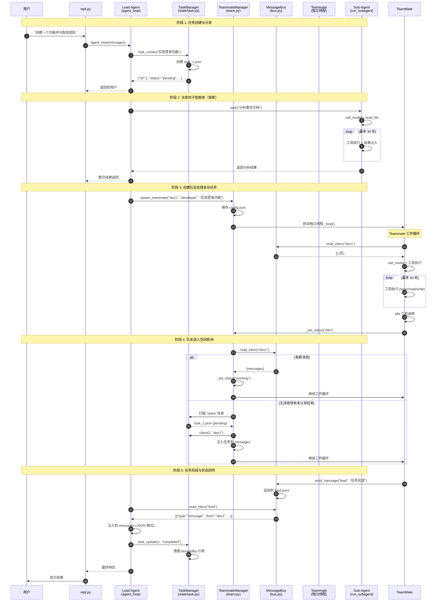

# 🔬 LocalDev Agent 核心模块深度剖析报告

## 1. 核心概念与数据模型定义 (Core Concepts)

### 1.1 任务模型：双层任务系统设计

这个项目采用了**双层任务系统**，区分了"短时规划"和"持久任务"。

#### Layer 1: TodoManager - 短时任务跟踪（内存级）

```python
# src/localdev/state/todo.py
@dataclass
class TodoItem:
    content: str      # 任务描述
    status: str       # "pending" | "in_progress" | "completed"
    activeForm: str   # 进行时态描述（如 "Fixing bug"）

@dataclass
class TodoManager:
    items: List[Dict[str, Any]] = field(default_factory=list)
```

**状态机设计**：
```
┌─────────┐    ┌─────────────┐    ┌───────────┐
│ pending │ -->│ in_progress │ -->│ completed │
└─────────┘    └─────────────┘    └───────────┘
     │              │                    │
     └──────────────┴────────────────────┘
              (可跳阶段)

约束规则:
1. 最多 20 个 todo 项
2. 同一时间只能有 1 个 in_progress
3. 必须有 content 和 activeForm
```

**使用场景**：单个任务内部的步骤分解（类似 Checklist）

#### Layer 2: TaskManager - 持久化任务管理（文件级）

```python
# src/localdev/state/task.py
@dataclass
class TaskManager:
    tasks_dir: Path = config.TASKS_DIR  # 默认 .tasks/

# 任务数据结构（JSON 格式存储）
{
    "id": 1,                    # 自增 ID
    "subject": "修复登录 bug",    # 简短标题
    "description": "...",        # 详细描述
    "status": "pending",         # pending | in_progress | completed | deleted
    "owner": "lead",            # 任务负责人（谁在执行）
    "blockedBy": [2, 3],        # 被哪些任务阻塞
    "blocks": [4, 5]            # 阻塞哪些任务
}
```

**状态机设计**：
```
                    ┌─────────────────────────────────────┐
                    │                                     ▼
    ┌─────────┐    ┌─────────────┐    ┌───────────┐  ┌──────────┐
    │ pending │ -->│ in_progress │ -->│ completed │-->│ deleted  │
    └─────────┘    └─────────────┘    └───────────┘  └──────────┘
         │              │                    │
         │              │                    │
         └──────────────┴────────────────────┘
              (状态可回退)

关键特性:
1. 任务完成时自动从 blocks 中移除
2. 支持任务依赖关系（blockedBy/blocks）
3. 支持任务抢占（claim）
```

**核心方法**：

```python
def create(subject, description="") -> str:
    # 创建新任务，返回 JSON
    task = {"id": _next_id(), "subject": subject, ...}
    _save(task)
    
def claim(tid, owner) -> str:
    # 认领任务（自动转为 in_progress）
    task["owner"] = owner
    task["status"] = "in_progress"
    
def update(tid, status=None, add_blocked_by=None, add_blocks=None):
    # 更新状态或依赖关系
    # 状态变为 completed 时，自动清理 blockedBy 引用
```

**对比表**：

| 维度 | TodoManager | TaskManager |
|------|-------------|-------------|
| 存储 | 内存（易失） | 文件（持久化） |
| 生命周期 | 单次对话 | 跨会话 |
| 用途 | 步骤分解 | 任务分配 |
| 依赖关系 | ❌ | ✅ |
| 所有者 | ❌ | ✅ |

---

### 1.2 智能体模型：三种角色模式

项目通过**工具集差异**和**系统提示词**来区分不同的智能体类型，而非继承关系。

#### 代码层面的区分

```python
# src/localdev/core/agent.py

# 1️⃣ Lead Agent (主智能体) - 全功能
def create_agent_context() -> AgentContext:
    # 拥有全部 25+ 个工具
    tools, handlers = build_tools_and_handlers(
        todo_mgr=todo, task_mgr=tasks, bg_mgr=bg,
        bus=bus, team=team, run_subagent_func=run_subagent
    )
    system_prompt = (
        f"You are a coding agent at {config.WORKDIR}. "
        "Prefer task_create/task_update/task_list for multi-step work. "
        "Use task for subagent delegation. Use load_skill for specialized knowledge."
    )
```

#### 2️⃣ Teammate (队友智能体) - 受限功能

```python
# src/localdev/multiagent/team.py

def _loop(self, name, role, prompt):
    # 队友只有 8 个工具（比 Lead 少）
    tools = [
        "bash", "list_dir", "read_file", "write_file", "edit_file",
        "send_message", "idle", "claim_task"  # ← 注意：没有 task, load_skill, compress
    ]
    sys_prompt = (
        f"You are '{name}', role: {role}, team: {team_name}. "
        "Use idle when done with current work. You may auto-claim tasks."
    )
```

#### 3️⃣ Sub-Agent (子智能体) - 临时隔离执行

```python
# src/localdev/core/agent.py

def run_subagent(prompt: str, agent_type: str = "Explore") -> str:
    """临时创建一个独立的小型 agent 循环"""
    
    # 根据类型决定工具集
    sub_tools = [
        {"name": "bash", ...},
        {"name": "read_file", ...},
    ]
    if agent_type != "Explore":
        sub_tools += [
            {"name": "write_file", ...},
            {"name": "edit_file", ...},
        ]
    
    # 独立的 messages 列表（上下文隔离）
    sub_msgs = [{"role": "user", "content": prompt}]
    
    # 独立循环（最多 30 轮）
    for _ in range(30):
        resp = call_model(messages=sub_msgs, tools=sub_tools)
        # ... 工具执行 ...
    
    return summary  # 返回总结
```

**三种模式对比**：

| 维度 | Lead Agent | Teammate | Sub-Agent |
|------|------------|----------|-----------|
| 生命周期 | 整个会话 | 显式 spawn/shutdown | 单次调用 |
| 线程模型 | 主线程同步 | 独立后台线程 | 同步阻塞 |
| 工具数量 | 25+ 个 | 8 个 | 2-4 个 |
| 上下文 | 共享主对话 | 独立 messages | 独立 messages |
| 通信方式 | 直接调用 | MessageBus | 返回值 |
| 持久化 | ❌ | ✅ (.team/config.json) | ❌ |

---

## 2. 交互机制与通信协议 (Communication & Protocol)

### 2.1 消息总线架构：文件型消息队列

#### 核心设计：基于文件的异步消息队列

```python
# src/localdev/multiagent/bus.py
@dataclass
class MessageBus:
    inbox_dir: Path = config.INBOX_DIR  # 默认 .team/inbox/
    
    def send(self, sender: str, to: str, content: str, 
             msg_type: str = "message", extra: dict = None) -> str:
        """发送消息到收件人的 inbox 文件"""
        msg = {
            "type": msg_type,
            "from": sender,
            "content": content,
            "timestamp": time.time(),
            **extra
        }
        # 追加写入收件人的 inbox 文件（JSONL 格式）
        path = self.inbox_dir / f"{to}.jsonl"
        with open(path, "a") as f:
            f.write(json.dumps(msg) + "\n")
        return f"Sent {msg_type} to {to}"
    
    def read_inbox(self, name: str) -> list[dict]:
        """读取并清空收件箱（保证每条消息只读一次）"""
        path = self.inbox_dir / f"{name}.jsonl"
        if not path.exists():
            return []
        msgs = [json.loads(l) for l in path.read_text().strip().splitlines()]
        path.write_text("")  # ← 清空，实现"读取即删除"
        return msgs
```

#### 文件结构示例

```
.team/inbox/
├── lead.jsonl      ← Lead Agent 的收件箱
├── researcher.jsonl ← researcher 队友的收件箱
└── reviewer.jsonl   ← reviewer 队友的收件箱

# lead.jsonl 内容示例 (JSONL 格式):
{"type": "message", "from": "researcher", "content": "发现一个问题...", "timestamp": 1234567890}
{"type": "shutdown_request", "from": "lead", "content": "Please shut down.", "timestamp": 1234567891}
```

### 2.2 消息协议定义

```python
# src/localdev/multiagent/protocol.py

VALID_MSG_TYPES = {
    "message",                    # 普通消息
    "broadcast",                  # 广播消息
    "shutdown_request",           # 关闭请求
    "shutdown_response",          # 关闭响应
    "plan_approval_response",     # 计划审批响应
}

# 消息结构（所有消息都遵循此格式）
{
    "type": str,              # 必填：消息类型
    "from": str,             # 必填：发送者
    "content": str,          # 必填：消息内容
    "timestamp": float,      # 必填：时间戳
    "request_id": str,       # 可选：请求 ID（用于握手）
    "feedback": str,         # 可选：反馈内容
    "approve": bool          # 可选：是否批准
}
```

### 2.3 通信模式对比

| 模式 | 实现方式 | 可靠性 | 适用场景 |
|------|----------|--------|----------|
| **点对点** | `bus.send(from, to, content)` | ✅ 文件持久化 | 一对一通信 |
| **广播** | `bus.broadcast(from, content, recipients)` | ✅ 文件持久化 | 一对多通知 |
| **请求 - 响应** | `shutdown_request` + `shutdown` | ⚠️ 无确认机制 | 控制命令 |
| **订阅** | 定时轮询 `read_inbox()` | ✅ 每次读取新消息 | 事件驱动 |

### 2.4 上下文隔离机制

**关键点**：每个智能体有独立的 `messages` 列表

```python
# Lead Agent - 共享主对话上下文
history: List[Dict] = []  # 在 repl.py 中维护

# Teammate - 独立上下文
def _loop(self, name, role, prompt):
    messages = [{"role": "user", "content": prompt}]  # ← 独立创建
    
# Sub-Agent - 独立上下文  
def run_subagent(prompt, agent_type):
    sub_msgs = [{"role": "user", "content": prompt}]  # ← 独立创建
```

**消息注入方式**：
- Lead Agent：用户输入直接追加到 history
- Teammate：inbox 消息序列化为 JSON 后追加
- Sub-Agent：初始 prompt + 工具结果循环

---

## 3. 核心流转场景：从任务派发到子智能体执行

### 3.1 完整链路时序图



### 3.2 关键代码片段解析

#### 阶段 1: 任务创建

```python
# 用户输入触发
User: "创建一个任务：实现用户登录功能"

# Lead Agent 调用工具
tools["task_create"]({
    "subject": "实现用户登录功能",
    "description": "包括表单验证、密码加密等"
})

# TaskManager.create() 执行
def create(self, subject, description=""):
    task = {
        "id": self._next_id(),           # 1
        "subject": subject,
        "description": description,
        "status": "pending",
        "owner": None,
        "blockedBy": [],
        "blocks": []
    }
    self._save(task)  # 写入 .tasks/task_1.json
    return json.dumps(task)
```

#### 阶段 2: 子智能体探索

```python
# Lead Agent 调用
tools["task"]({
    "prompt": "阅读需求文档并总结要点",
    "agent_type": "Explore"  # 只有 read + bash
})

# run_subagent() 执行独立的 agent 循环
def run_subagent(prompt, agent_type="Explore"):
    sub_msgs = [{"role": "user", "content": prompt}]
    for _ in range(30):  # 最多 30 轮
        resp = call_model(messages=sub_msgs, tools=sub_tools)
        if resp.stop_reason != "tool_use":
            break
        # 执行工具并追加结果
        for block in resp.content:
            if block.type == "tool_use":
                result = sub_handlers[block.name](**block.input)
                sub_msgs.append({"role": "user", "content": result})
    return resp.content[0].text  # 返回总结
```

#### 阶段 3: 队友创建与启动

```python
# Lead Agent 调用
tools["spawn_teammate"]({
    "name": "dev1",
    "role": "developer",
    "prompt": "实现用户登录功能"
})

# TeammateManager.spawn() 执行
def spawn(self, name, role, prompt):
    # 保存到配置
    member = {"name": name, "role": role, "status": "working"}
    self.config["members"].append(member)
    self._save()
    
    # 启动独立线程
    t = threading.Thread(
        target=self._loop,
        args=(name, role, prompt),
        daemon=True
    )
    t.start()
    self.threads[name] = t
```

#### 阶段 4: 队友工作循环

```python
# TeammateManager._loop() - 核心循环
def _loop(self, name, role, prompt):
    messages = [{"role": "user", "content": prompt}]
    
    while True:
        # --- 工作阶段 (最多 50 轮) ---
        for _ in range(50):
            # 读取收件箱
            inbox = self.bus.read_inbox(name)
            for msg in inbox:
                if msg.get("type") == "shutdown_request":
                    self._set_status(name, "shutdown")
                    return
                messages.append({"role": "user", "content": json.dumps(msg)})
            
            # LLM 调用
            response = call_model(system=sys_prompt, messages=messages, tools=tools)
            messages.append({"role": "assistant", "content": response.content})
            
            if response.stop_reason != "tool_use":
                break
                
            # 工具执行
            for block in response.content:
                if block.type == "tool_use":
                    if block.name == "idle":
                        idle_requested = True
                    elif block.name == "claim_task":
                        output = self.task_mgr.claim(block.input["task_id"], name)
                    # ... 其他工具
                    
            if idle_requested:
                break
        
        # --- 空闲阶段 (轮询消息和任务) ---
        self._set_status(name, "idle")
        for _ in range(IDLE_TIMEOUT // POLL_INTERVAL):
            time.sleep(POLL_INTERVAL)
            
            # 检查消息
            inbox = self.bus.read_inbox(name)
            if inbox:
                resume = True
                break
            
            # 检查未认领任务
            for f in sorted(config.TASKS_DIR.glob("task_*.json")):
                t = json.loads(f.read_text())
                if t["status"] == "pending" and not t["owner"]:
                    self.task_mgr.claim(t["id"], name)
                    messages.append({
                        "role": "user",
                        "content": f"<auto-claimed>Task #{t['id']}: {t['subject']}</auto-claimed>"
                    })
                    resume = True
                    break
            
            if not resume:
                self._set_status(name, "shutdown")
                return
            
            self._set_status(name, "working")
```

---

## 4. 源码阅读建议 (Reading Guide)

### 4.1 核心文件阅读顺序

| 优先级 | 文件 | 重点关注 | 阅读目标 |
|--------|------|----------|----------|
| **1** | `src/localdev/state/task.py` | `TaskManager.create`, `TaskManager.claim`, `TaskManager.update` | 理解任务数据结构与状态流转 |
| **2** | `src/localdev/multiagent/bus.py` | `MessageBus.send`, `MessageBus.read_inbox` | 理解消息队列机制 |
| **3** | `src/localdev/multiagent/team.py` | `TeammateManager._loop` | 理解队友生命周期 |
| **4** | `src/localdev/core/agent.py` | `run_subagent`, `create_agent_context` | 理解子智能体模式 |
| **5** | `src/localdev/tools/system.py` | `BackgroundManager.run`, `BackgroundManager._exec` | 理解后台任务 |

### 4.2 阅读技巧

```python
# 建议的断点调试路径：

# 1. 任务创建
breakpoint()  # 在 TaskManager.create() 第一行

# 2. 队友启动  
breakpoint()  # 在 TeammateManager.spawn() 启动线程处

# 3. 队友循环
breakpoint()  # 在 TeammateManager._loop() while True 处

# 4. 消息发送
breakpoint()  # 在 MessageBus.send() 写入文件处
```

---

## 5. 项目流程完整讲解

### 5.1 启动流程

```
┌─────────────────────────────────────────────────────────────┐
│                    启动阶段                                   │
├─────────────────────────────────────────────────────────────┤
│  1. run.py 执行                                             │
│     └─> 添加 src/ 到 sys.path                               │
│     └─> 导入 run_repl()                                     │
│                                                           │
│  2. run_repl() 调用 create_agent_context()                 │
│     └─> 初始化 TodoManager (内存任务)                      │
│     └─> 初始化 TaskManager (.tasks/ 目录)                  │
│     └─> 初始化 BackgroundManager (后台任务)                │
│     └─> 初始化 MessageBus (.team/inbox/ 目录)              │
│     └─> 初始化 TeammateManager (.team/config.json)         │
│     └─> 初始化 SkillLoader (skills/ 目录)                  │
│     └─> 调用 build_tools_and_handlers() 构建工具集         │
│                                                           │
│  3. REPL 显示提示符 "localdev >> " 等待输入                 │
└─────────────────────────────────────────────────────────────┘
```

### 5.2 用户请求处理流程

```
┌─────────────────────────────────────────────────────────────┐
│                   请求处理循环                               │
├─────────────────────────────────────────────────────────────┤
│                                                             │
│  ┌──────────────────────────────────────────────────────┐  │
│  │  用户输入："帮我创建一个登录功能"                     │  │
│  └──────────────────────────────────────────────────────┘  │
│                            │                                │
│                            ▼                                │
│  ┌──────────────────────────────────────────────────────┐  │
│  │  1. 添加用户消息到 history                            │  │
│  │     history.append({"role": "user", "content": ...}) │  │
│  └──────────────────────────────────────────────────────┘  │
│                            │                                │
│                            ▼                                │
│  ┌──────────────────────────────────────────────────────┐  │
│  │  2. 调用 agent_loop(ctx, history)                    │  │
│  │                                                      │  │
│  │     ┌──────────────────────────────────────────────┐ │  │
│  │     │ while True:                                  │ │  │
│  │     │                                              │ │  │
│  │     │  A. 上下文压缩                               │ │  │
│  │     │     microcompact(history)                    │ │  │
│  │     │     if tokens > 100k: auto_compact()        │ │  │
│  │     │                                              │ │  │
│  │     │  B. 后台任务通知注入                         │ │  │
│  │     │     notifs = ctx.bg.drain()                 │ │  │
│  │     │     if notifs: history.append(notifs)       │ │  │
│  │     │                                              │ │  │
│  │     │  C. 消息总线收件箱注入                       │ │  │
│  │     │     inbox = ctx.bus.read_inbox("lead")      │ │  │
│  │     │     if inbox: history.append(inbox)         │ │  │
│  │     │                                              │ │  │
│  │     │  D. LLM 调用                                  │ │  │
│  │     │     response = call_model(system, history,   │ │  │
│  │     │                          tools)              │ │  │
│  │     │     history.append(assistant_response)       │ │  │
│  │     │                                              │ │  │
│  │     │  E. 判断是否需要工具                         │ │  │
│  │     │     if response.stop_reason != "tool_use":   │ │  │
│  │     │         return  ← 结束循环                   │ │  │
│  │     │                                              │ │  │
│  │     │  F. 工具执行                                 │ │  │
│  │     │     for block in response.content:           │ │  │
│  │     │         if block.type == "tool_use":         │ │  │
│  │     │             result = handlers[name](**input) │ │  │
│  │     │             history.append(tool_result)      │ │  │
│  │     │                                              │ │  │
│  │     │  G. 循环回到 A                               │ │  │
│  │     └──────────────────────────────────────────────┘ │  │
│  └──────────────────────────────────────────────────────┘  │
│                            │                                │
│                            ▼                                │
│  ┌──────────────────────────────────────────────────────┐  │
│  │  3. 返回最终响应给用户                               │  │
│  └──────────────────────────────────────────────────────┘  │
│                                                             │
└─────────────────────────────────────────────────────────────┘
```

### 5.3 工具调用分支

当用户请求需要特定能力时：

```
用户请求："创建一个功能并分配给团队处理"
                    │
                    ▼
            ┌───────────────┐
            │   LLM 决策     │
            └───────────────┘
                    │
    ┌───────────────┼───────────────┬────────────────┐
    │               │               │                │
    ▼               ▼               ▼                ▼
┌──────┐       ┌──────┐       ┌──────┐         ┌──────┐
│任务  │       │子智能体│      │队友   │         │后台  │
│管理  │       │探索   │      │协作   │         │任务  │
└──────┘       └──────┘       └──────┘         └──────┘
    │              │             │                │
    ▼              ▼             ▼                ▼
task_       run_          spawn_          background_
create()    subagent()    teammate()      run()

执行路径:
├─ task_create() ──> TaskManager.create() ──> 写入 .tasks/task_N.json
├─ task() ────────> run_subagent() ───────> 独立循环 30 轮 ──> 返回总结
├─ spawn_teammate() ─> TeammateManager.spawn() ─> 启动独立线程
└─ background_run() ─> BackgroundManager.run() ─> 启动后台线程
```

### 5.4 队友生命周期完整流程

```
┌─────────────────────────────────────────────────────────────┐
│                    队友生命周期                              │
├─────────────────────────────────────────────────────────────┤
│                                                             │
│  [SPAWN]  spawn_teammate("dev1", "developer", prompt)       │
│       │                                                    │
│       ▼                                                    │
│  ┌──────────────────────────────────────────────────────┐  │
│  │  1. 保存到 .team/config.json                          │  │
│  │     {"members": [{"name": "dev1", "role": "developer",│  │
│  │                  "status": "working"}]}               │  │
│  │                                                       │  │
│  │  2. 启动独立线程                                       │  │
│  │     threading.Thread(target=_loop, daemon=True)       │  │
│  └──────────────────────────────────────────────────────┘  │
│       │                                                    │
│       ▼                                                    │
│  ┌──────────────────────────────────────────────────────┐  │
│  │  [WORK PHASE] 工作阶段                                │  │
│  │                                                       │  │
│  │  for _ in range(50):  ← 最多 50 轮                     │  │
│  │      1. 读取收件箱                                    │  │
│  │      2. LLM 调用                                       │  │
│  │      3. 工具执行 (bash/read/write/edit)              │  │
│  │      4. 如果调用 idle 工具 → 进入空闲阶段              │  │
│  │                                                       │  │
│  │  状态：working                                        │  │
│  └──────────────────────────────────────────────────────┘  │
│       │                                                    │
│       ▼                                                    │
│  ┌──────────────────────────────────────────────────────┐  │
│  │  [IDLE PHASE] 空闲阶段                                │  │
│  │                                                       │  │
│  │  状态：idle                                           │  │
│  │                                                       │  │
│  │  for _ in range(IDLE_TIMEOUT // POLL_INTERVAL):      │  │
│  │      sleep(POLL_INTERVAL)  ← 每 5 秒轮询               │  │
│  │                                                       │  │
│  │      检查 1: read_inbox() → 有新消息？                │  │
│  │          └─> YES: 返回工作阶段                        │  │
│  │                                                       │  │
│  │      检查 2: 扫描 .tasks/ → 有未认领任务？            │  │
│  │          └─> YES: claim() + 注入到 messages           │  │
│  │                  返回工作阶段                         │  │
│  │                                                       │  │
│  │  超时未找到任务 → SHUTDOWN                            │  │
│  └──────────────────────────────────────────────────────┘  │
│       │                                                    │
│       ▼                                                    │
│  ┌──────────────────────────────────────────────────────┐  │
│  │  [SHUTDOWN] 关闭                                      │  │
│  │                                                       │  │
│  │  方式 1: 收到 shutdown_request 消息                    │  │
│  │  方式 2: 空闲超时                                      │  │
│  │  方式 3: 异常退出                                      │  │
│  │                                                       │  │
│  │  _set_status(name, "shutdown")                        │  │
│  │  return                                               │  │
│  └──────────────────────────────────────────────────────┘  │
│                                                             │
└─────────────────────────────────────────────────────────────┘
```

### 5.5 数据持久化概览

```
项目根目录/
├── .tasks/                    ← TaskManager 存储
│   ├── task_1.json           {"id": 1, "subject": "...", "status": "pending", ...}
│   ├── task_2.json
│   └── ...
│
├── .team/                     ← TeammateManager + MessageBus 存储
│   ├── config.json           {"team_name": "default", "members": [...]}
│   └── inbox/                ← 每个队友的收件箱
│       ├── lead.jsonl
│       ├── dev1.jsonl
│       └── ...
│
├── .transcripts/              ← memory.auto_compact() 存储
│   ├── transcript_1709876543.jsonl
│   └── ...
│
└── skills/                    ← SkillLoader 加载
    ├── agent-builder/
    │   └── SKILL.md
    └── ...
```

---

## 总结：核心机制速查表

| 机制 | 文件 | 核心类/函数 | 关键参数 |
|------|------|-------------|----------|
| 任务创建 | state/task.py | TaskManager.create() | subject, description |
| 任务认领 | state/task.py | TaskManager.claim() | tid, owner |
| 任务更新 | state/task.py | TaskManager.update() | tid, status, blockedBy, blocks |
| 消息发送 | multiagent/bus.py | MessageBus.send() | sender, to, content, type |
| 消息读取 | multiagent/bus.py | MessageBus.read_inbox() | name |
| 队友创建 | multiagent/team.py | TeammateManager.spawn() | name, role, prompt |
| 队友循环 | multiagent/team.py | TeammateManager._loop() | - |
| 子智能体 | core/agent.py | run_subagent() | prompt, agent_type |
| 后台任务 | tools/system.py | BackgroundManager.run() | command, timeout |